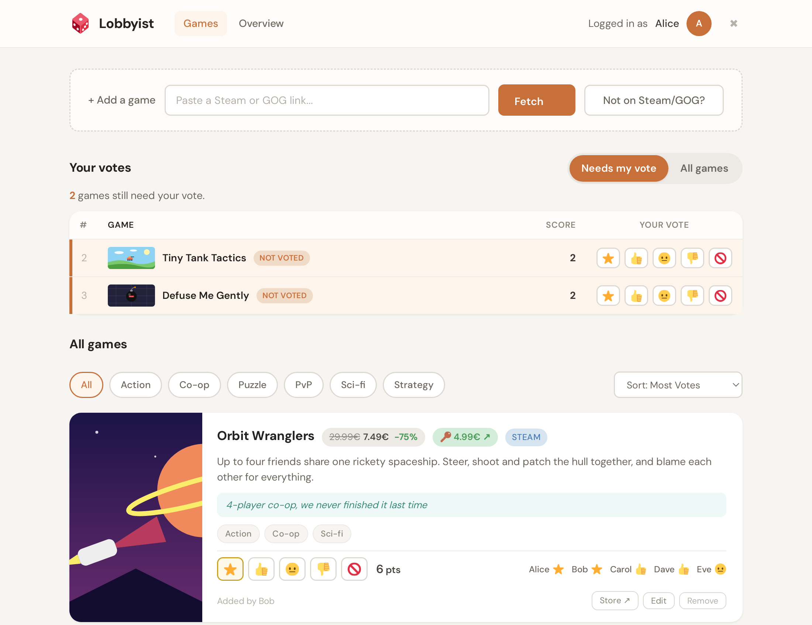
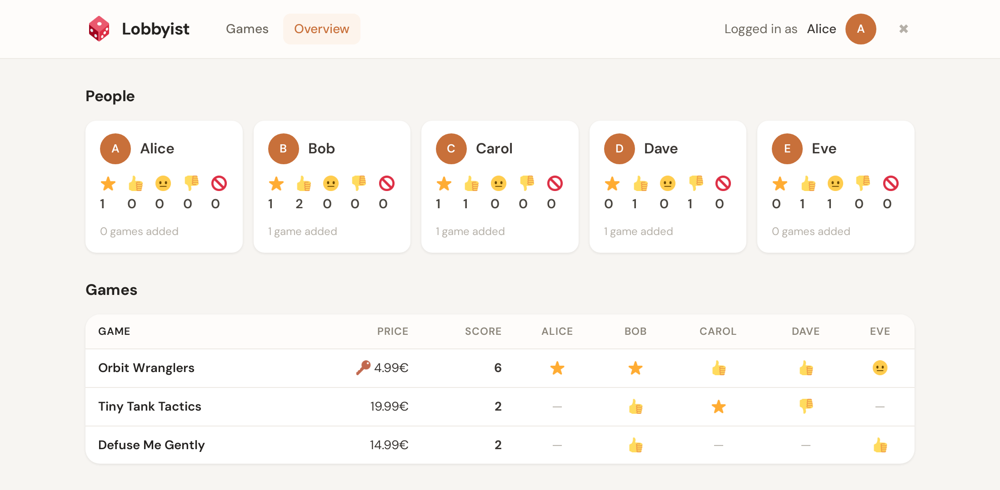

# Lobbyist

Lobby for your game. Vote on all of them. Download before the LAN.

A small self-hosted web app for deciding what to play at your next LAN party.

Everyone in the group can suggest games, vote on them, and see what the others picked.
Paste a Steam or GOG link and the app fills in the title, image, price, and tags for you.
Votes show up live in everyone's browser, so you don't have to refresh.

<p align="center">
  
</p>

<p align="center">· · ·</p>

<p align="center">
  
</p>

## Features

- Add games from Steam or GOG links, or enter them by hand
- Vote from "veto" to "must play" and see who voted for what
- Filter by tag and sort by votes
- Overview table with every player's vote on every game
- Store prices and sales, plus an optional cheaper key price
- Game images are cached locally
- Optional site-wide password
- Single binary with an SQLite database, no external services needed

## Quick start

### With Docker

Edit the player names and password in `docker-compose.yml`, then start it:

```sh
docker compose up -d
```

Open <http://localhost:8080>, enter the password, and pick your name.

### Without Docker

You need Go 1.27 or newer.

```sh
go build -o lobbyist .
./lobbyist -users "Alice,Bob,Carol"
```

The app listens on port 8080 and stores its data in `./data`.

## Configuration

Every option can be set as a command-line flag or as an environment variable.

| Flag | Environment variable | Default | Description |
|---|---|---|---|
| `-addr` | `LPP_ADDR` | `:8080` | Listen address |
| `-data` | `LPP_DATA_DIR` | `./data` | Directory for the database and cached images |
| `-users` | `LPP_USERS` | | Comma-separated list of players, only used on first start |
| `-password` | `LPP_PASSWORD` | | Site-wide password (disabled if empty) |
| `-cc` | `LPP_STEAM_CC` | `de` | Country code for Steam prices, e.g. `fr` or `at` |
| `-base-path` | `LPP_BASE_PATH` | | Serve the app under a sub-path, e.g. `/lan` |

`LPP_USERS` only creates users when the database is still empty.
To change the player list later, delete the database in the data directory or edit it directly.

The site password is a simple shared secret to keep strangers out.
If you expose the app to the internet, put it behind a reverse proxy with HTTPS.

## Built with

Go, SQLite ([ncruces/go-sqlite3](https://github.com/ncruces/go-sqlite3)), and [htmx](https://htmx.org/).

## License

MIT, see [LICENSE](LICENSE).

## Disclaimer

This project was largely written with the help of AI (Claude Code).
It works well for our group, but it has not been reviewed or tested beyond that.
Use it at your own risk, and feel free to open an issue if something breaks.
